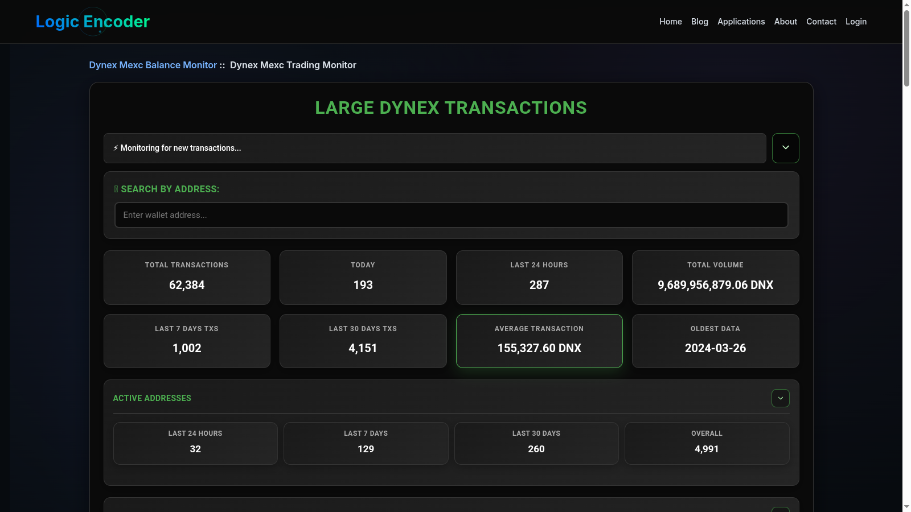

# Dynex Large Transactions — Chain Monitor

A chain-wide transaction feed can make significant DNX movements difficult to follow. Dynex Large Transactions keeps transfers above the operator's chosen size together, with recent activity, historical investigation and a public WordPress feed connected to the same monitoring routine.

Explore the [published transaction monitor](https://logicencoder.com/dynex-large-transactions-monitor/) for the visitor-facing experience. The chain monitor supplies the observations and gives the operator the tools to review, retain and republish them.

## Tech stack

| Layer | Technologies |
|---|---|
| Application | Python |
| Chain access | Dynex |
| History and exports | SQLite, CSV |
| Publishing | WordPress |

## Focus on larger movements

A threshold defines which transfers belong in the feed. The menu offers a default of 9,998 DNX or a custom value, and the value can also be given with `-t`. Qualifying transfers keep their block, hash, sender, receiver and amount.

The size threshold gives the monitor a clear purpose: it narrows chain activity to a selected range without suggesting that size alone explains a transaction.

## Review current activity and history

The live mode follows new blocks. A lookback processes a chosen number of earlier blocks, optionally from a given start block, in parallel chunks across several processor cores with an optional RAM cache for block data, and older log files can be imported (`--import-log`) to restore history.

Historical catch-up and an initial publication option also help restore a website's recent context after an interruption or a publishing change.

## Investigate an address

An address can be tracked, its transaction history viewed for a block range and exported to CSV; a mining-only mode restricts the view to mining rewards, and an address collection pass gathers every unique address on the chain, with tools to fix miner flags and update balances.

A wider address directory and balance-related tools support questions that begin with participants rather than the latest large transfer. They remain part of the operator's research workflow.

## Publish to the sites that need it

One or several WordPress sites are configured with a URL, an access key and an optional name (`-w`, `-k`, `-n`). `--auto-send` delivers new transactions as they are found, `--send-initial` sends the transactions already in the database, and each site's result is reported separately.

Per-site outcomes let the operator distinguish a functioning chain monitor from a publishing destination that needs attention. The companion plugin handles how visitors browse the resulting feed.

## Maintain the observation collection

The operator can inspect recent records, import supported older logs and maintain the address information used in research. General, large-transfer and address-focused activity records support different kinds of follow-up.

These tools are useful when a question cannot be answered by the current public page alone, such as reviewing an older event or preparing a focused address export.

## Choose an interactive or ongoing routine

Interactive controls support preparation, inspection and occasional research. Unattended operation supports the longer-running task of keeping new observations and public pages supplied.

The product connects those routines so a narrow live feed does not come at the expense of historical context or the ability to inspect a specific transaction later.

---

Private code: [dynex-large-transactions-plugin](https://github.com/logicencoder/dynex-large-transactions-plugin)

[WordPress transaction dashboard](https://github.com/logicencoder/dynex-large-transactions-plugin-overview)

See [REPOS.md](REPOS.md) for related repositories.

**[Logic Encoder](https://logicencoder.com)** · [GitHub](https://github.com/logicencoder) · [Contact](https://logicencoder.com/contact/)
