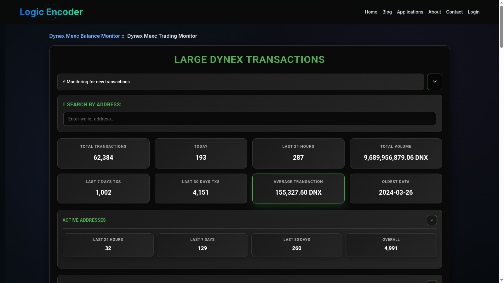

# Dynex Large Transactions — Chain Monitor

A chain-wide transaction feed can make significant DNX movements difficult to follow. Dynex Large Transactions keeps transfers above the operator's chosen size together, with recent activity, historical investigation and a public WordPress feed connected to the same monitoring routine.

Explore the [published transaction monitor](https://logicencoder.com/dynex-large-transactions-monitor/) for the visitor-facing experience. The chain monitor supplies the observations and gives the operator the tools to review, retain and republish them.

## Tech stack

| Layer | Technologies |
|---|---|
| Application | Python |
| Chain access | Dynex |
| History and exports | SQLite, CSV |
| Publishing | WordPress |

## Focus on larger movements

A configurable threshold defines which transfers belong in the monitored feed. Qualifying observations retain their transaction references so an interesting movement can be examined beyond its summary.

The size threshold gives the monitor a clear purpose: it narrows chain activity to a selected range without suggesting that size alone explains a transaction.

## Review current activity and history

The live view supports following new blocks, while historical lookback lets the operator investigate an earlier range. Retained observations make it possible to revisit an event after it has passed through the live feed.

Historical catch-up and an initial publication option also help restore a website's recent context after an interruption or a publishing change.

## Investigate an address

Address tools support reviewing a selected wallet across a chosen block range, with regular and mining-related activity available for more focused investigation. Recorded results can be inspected or exported for later review.

A wider address directory and balance-related tools support questions that begin with participants rather than the latest large transfer. They remain part of the operator's research workflow.

## Publish to the sites that need it

The same monitored activity can be delivered to several configured WordPress destinations. Automatic publication keeps the public feed supplied, while manual history publication helps when a site needs an existing slice of observations again.

Per-site outcomes let the operator distinguish a functioning chain monitor from a publishing destination that needs attention. The companion plugin handles how visitors browse the resulting feed.

## Maintain the observation collection

The operator can inspect recent records, import supported older logs and maintain the address information used in research. General, large-transfer and address-focused activity records support different kinds of follow-up.

These tools are useful when a question cannot be answered by the current public page alone, such as reviewing an older event or preparing a focused address export.

## Choose an interactive or ongoing routine

Interactive controls support preparation, inspection and occasional research. Unattended operation supports the longer-running task of keeping new observations and public pages supplied.

The product connects those routines so a narrow live feed does not come at the expense of historical context or the ability to inspect a specific transaction later.

---

Private code: [dynex-large-transactions-plugin](https://github.com/logicencoder/dynex-large-transactions-plugin)

[WordPress transaction dashboard](https://github.com/logicencoder/dynex-large-transactions-plugin-overview)

See [REPOS.md](REPOS.md) for related repositories.

**[Logic Encoder](https://logicencoder.com)** · [GitHub](https://github.com/logicencoder) · [Contact](https://logicencoder.com/contact/)
